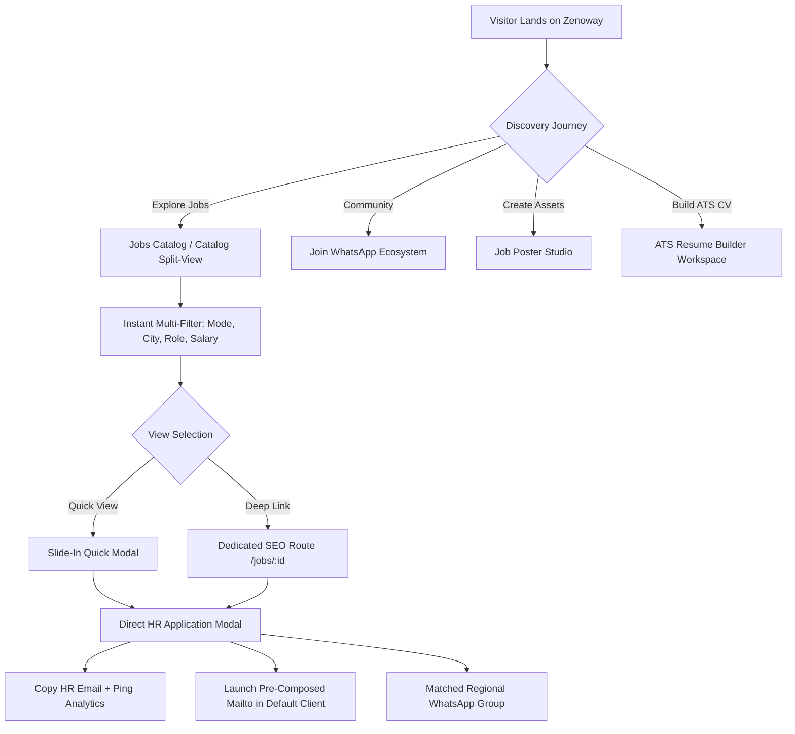

# Zenoway — Portfolio Case Study Source Report

> **Target Roles:** UI Developer · Frontend UI Developer · UI-Focused Design Engineer  
> **Author / Creator:** Aswanth U P  
> **Live Production Application:** [zenoway.online](https://zenoway.online)  
> **Portfolio Reference:** [aswanthup.online/projects/zenoway](https://www.aswanthup.online/projects/zenoway)  
> **Workspace Analyzed:** `c:\Users\PAVLION\uxion`  
> **Date of Report Generation:** November 15, 2026  
> **Document Purpose:** Definitive, evidence-backed technical report and portfolio repository source for presenting Zenoway as a flagship case study.

---

## Verification Legend
Every statement and observation in this report is explicitly classified under one of four evidence tiers:
* **[Verified from source code]**: Confirmed directly by inspecting application source code, configuration files, Git commit history, or database schemas in `c:\Users\PAVLION\uxion`.
* **[Observed from the live application]**: Verified from the deployed live platform at `zenoway.online` or public portfolio case study at `aswanthup.online/projects/zenoway`.
* **[Inferred and requiring confirmation]**: Deduced with strong technical probability from architectural patterns, comments, or UI states; requires user confirmation before publishing.
* **[Not available or not verified]**: Metrics, analytics numbers, or user-specific outcomes that cannot be validated from static source code alone.

---

## 1. Executive Summary

**Zenoway** is a specialized, production-grade career platform engineered specifically for UI/UX designers, frontend developers, and creative technology professionals across India. Built from the ground up as a responsive, high-performance Next.js application, Zenoway addresses the deep structural friction of traditional recruitment platforms—characterized by intrusive account walls, 10-step candidate screening questionnaires, automated ATS "black holes," and stale aggregator scrapings—by introducing a radical **"Direct Action" paradigm**. On Zenoway, every verified job listing provides direct employer contact (verified HR emails, pre-composed application subjects, deep `mailto:` automation, and clipboard fallback utilities), localized WhatsApp and Telegram community matching across 14 disciplines and 9 regions, an in-browser canvas-based Social Job Poster Studio with dynamic QR codes, and a comprehensive rule-based ATS Resume Builder workspace.

From a design engineering and UI development perspective, Zenoway serves as a textbook demonstration of:
1. **A CSS-First Design System in Tailwind CSS v4:** Built on strict design tokens (`@theme`), a bespoke brand palette (*Zenoway Emerald*), fluid responsive typography (Manrope, Space Grotesk, Plus Jakarta Sans, Playfair Display, Syne), and semantic layout variables.
2. **Desktop Workbench & Mobile Sheet Ergonomics:** Pinned viewport architecture (`h-dvh`) with isolated, overscroll-contained scroll panes (`lg:overflow-hidden` with nested independent scroll areas) eliminating jarring double-scrollbars on desktop, paired with gesture-friendly bottom sheets and popovers on mobile devices.
3. **Complex Interactive Workspaces:** Two standalone browser-based authoring suites:
   - A multi-format **Social Job Poster Creator** (`html-to-image`, dynamic SVG/canvas QR generation, custom typographic pairings, portrait cutout layering, and 2x retina export).
   - An in-depth **ATS Resume Builder & Analyzer** featuring 9 automated audit categories, real-time page budget constraint solvers (`pdf-lib`), live document previews, and Google Gemini AI assistance.
4. **Resilient Data Architecture & Enterprise Defenses:** Hybrid server-side rendering (SSR/ISR) with Supabase PostgreSQL, 500-row PostgREST chunking to prevent silent query truncation, DNS MX record validation for employer contact emails, Google Indexing API automation, and cryptographic HMAC-SHA256 admin session protection via Next.js 16 Edge proxying.

---

## 2. Product Overview

### 2.1 What Zenoway Is
Zenoway is a niche career and talent platform dedicated to connecting digital product creators—primarily UI/UX Designers, Product Designers, Frontend Developers, React/Next.js Engineers, and Design Technologists—with verified employers hiring across India and remote-first distributed teams. **[Verified from source code: `src/app/layout.tsx` #L53-L70, `src/data/categories.ts`].**

### 2.2 The Problem It Solves
Traditional hiring boards (Naukri, LinkedIn, Indeed, Glassdoor) present systemic friction for early-career to senior creative technologists:
1. **The "Candidate Black Hole":** Job seekers upload resumes into opaque enterprise ATS software where profiles are filtered out by rigid keyword parsers before any human recruiter ever sees them.
2. **Account Creation & Onboarding Fatigue:** Candidates must create a distinct account, verify an email, upload a resume, and manually re-enter their entire work history across proprietary forms for every single application.
3. **Stale & Ghost Listings:** Aggregator scrapers frequently display outdated, expired, or phantom postings with inactive company email addresses.
4. **Lack of Domain Specificity:** Generic platforms fail to capture nuanced design and frontend metadata (e.g., design system experience, Figma-to-code competencies, specific CSS/React component libraries, remote vs. local branch preferences).

### 2.3 Target Users and Needs
* **Job Seekers (UI/UX Designers & Frontend Developers):** Need frictionless access to active opportunities, transparency regarding salaries and work setups (On-site / Hybrid / Remote), instant localized peer communities, and a direct line to hiring managers without registration walls. **[Verified from source code: `src/app/jobs/JobsClient.tsx`, `src/app/jobs/[id]/ApplyModal.tsx`].**
* **Employers & Recruiters:** Need to hire qualified design and frontend talent without paying prohibitive listing fees on legacy enterprise platforms, want automated assistance formatting messy job descriptions into professional listings, require valid candidate reachability, and need branded social media assets to amplify openings across LinkedIn, Instagram, and WhatsApp. **[Verified from source code: `src/app/admin/comp/JobFormWizard.tsx`, `src/components/job-posters/JobPosterCreator.tsx`].**
* **Referral Partners & Campus Communities:** Community leads and alumni networks looking to share vetted opportunities and track application engagement. **[Verified from source code: `src/app/referral/page.tsx`, `src/app/referral-dashboard/page.tsx`].**

### 2.4 Main Value Proposition
* **Zero-Friction "One Action" Application Flow:** Job seekers can discover a role and reach the hiring team in under 10 seconds through verified direct email links, pre-formatted email templates, or direct company links without signing up or creating a profile. **[Observed from the live application & Verified from `ApplyModal.tsx`].**
* **Verified Direct Contact:** Listings feature verified corporate HR recruitment addresses validated via DNS MX checks before publication. **[Verified from `src/lib/validation/email.ts`].**
* **Community-Centric Amplification:** Integrated hyper-local WhatsApp networks that automatically match candidate domains and locations to regional alert groups. **[Verified from `src/lib/community/match-group.ts`].**

---

## 3. Features and User Journeys

### 3.1 Implemented & Production-Ready Features



#### A. Job Discovery, Search, and Multi-Criteria Filtering
* **Dual Browsing Paradigms:** Responsive grid on catalog routes (`/jobs`) with seamless transition to an interactive quick modal on desktop, paired with a permanent canonical route (`/jobs/[id]`) with full OpenGraph and JSON-LD metadata for search engines and direct sharing. **[Verified from `src/app/jobs/(catalog)/page.tsx` and `src/app/jobs/[id]/page.tsx`].**
* **Compound Search Engine:** Real-time client-side evaluation matching keywords across job titles, company names, categories, descriptions, and experience requirements without round-trip latency. **[Verified from `JobsClient.tsx` #L517-L575].**
* **Keyboard-Navigable Location Autocomplete:** Custom popover dropdown powered by canonical Indian cities (`CANONICAL_CITIES`), Indian states (`INDIAN_STATES`), and dynamic discovery of office locations from live jobs. Features alias resolution (e.g., typing "Bangalore" matches "Bengaluru"; "Bombay" matches "Mumbai") and arrow-key navigation (`ArrowDown`, `ArrowUp`, `Enter`, `Escape`). **[Verified from `JobsClient.tsx` #L454-L514 and `src/lib/supabase/locations-data.ts`].**
* **1-Click Work Mode Segmented Switcher:** Instant toggles for "All modes", "Remote", "Hybrid", and "On-site" displaying live category badges. **[Verified from `JobsClient.tsx` #L914-L955].**
* **Granular Facets:** Experience levels ("Entry level", "0–2 years", "1–3 years", etc.), minimum monthly salary floors (₹15,000+ to ₹1,00,000+), job categories, and sort orders ("Most recent", "Salary: high to low", "Company A–Z"). **[Verified from `JobsClient.tsx` #L733-L911].**
* **Local Bookmarking:** Persistent saved jobs system stored in browser `localStorage` (`zenoway_saved_jobs`) with an instant filter tab to review saved roles offline. **[Verified from `JobsClient.tsx` #L280-L312].**
* **IntersectionObserver Infinite Paging:** 12-item incremental slice pagination with bottom sentinel detection and manual "Load more roles" fallback. **[Verified from `JobsClient.tsx` #L649-L664].**

#### B. Direct Application Flow & Employer Contact
* **Direct HR Application Modal (`ApplyModal.tsx`):** Triggered by clicking "Apply now". Eliminates third-party redirects whenever an HR recruitment email is present.
  - Displays the verified recruiter contact email with one-click copy.
  - Generates a contextual subject line (`Application for [Job Title] at [Company]`) with independent clipboard copy.
  - Pre-composes a clean `mailto:` URI pre-filling the subject and an executive opening body text.
  - Telemetry: Dispatches an asynchronous analytics beacon to `/api/jobs/copy` upon successful clipboard copy to track application interest. **[Verified from `ApplyModal.tsx` #L108-L115].**
  - Robust Clipboard Fallback: Detects `navigator.clipboard` and `isSecureContext`; falls back to an off-screen `document.execCommand('copy')` textarea for legacy environments. **[Verified from `ApplyModal.tsx` #L27-L58].**

#### C. In-Browser Social Job Poster Studio (`/job-posters`)
* **Multi-Format Canvas Engine (`JobPosterCreator.tsx`, `PosterCanvas.tsx`):** Transforms any active job posting into a branded, print- and social-ready graphic in seconds.
  - **3 Social Aspect Ratios:** Feed (4:5, 1080×1350), Square (1:1, 1080×1080), Story (9:16, 1080×1920).
  - **5 Editorial Visual Themes:** Bold, Portrait, Minimal, Corporate, Compact.
  - **Dynamic Vector QR Generation:** Embeds custom SVG/Canvas QR codes (`@ttsalpha/qrcode`) linking directly to the job's canonical URL.
  - **Integrated Portrait Library:** 6 curated Indian professional portrait cutouts (Rohan, Aryan, Kabir, Priya, Aanya, Diya) with optical positioning.
  - **5 Google Font Pairings:** Manrope, Space Grotesk, Plus Jakarta Sans, Playfair Display, Syne.
  - **High-DPI Retina Rendering:** Exports clean PNG/JPEG blobs at 1x or 2x resolution via `html-to-image`, incorporating custom font embed stylesheets (`getFontEmbedCSS`) and image pre-decoding to eliminate font-swap flickers or missing images during canvas rasterization. **[Verified from `JobPosterCreator.tsx` #L72-L94].**

#### D. ATS Resume Builder & AI Sidekick (`/resume-builder`)
* **Production-Grade ATS Engine:** A full-featured builder with live split-screen editor/preview.
  - **9 ATS Audit Categories:** Evaluates Spelling & Grammar, Experience & Impact, Dates & Chronology, Job Keywords, Formatting & Parsing, Layout & Page Budget, Contact Details, Standard Sections, and Entry Completeness. **[Verified from `src/lib/resume/ats-checker.ts`].**
  - **Automated Fix Engine:** Provides one-click text replacement, skill injection, and section reordering.
  - **Deterministic Vector PDF Export:** Uses `pdf-lib` to construct search-engine-readable vector PDFs directly in memory with exact A4 page budgeting (`A4_WIDTH_PT = 595.28`, `A4_HEIGHT_PT = 841.89`), WinAnsi sanitization, and clickable hyperlinked PDF annotations for GitHub, LinkedIn, and portfolios. **[Verified from `src/lib/resume/pdf.ts`].**
  - **AI Optimization:** Integrated with Google Gemini models (`gemini-3.5-flash`) via `/api/resume/ai` for bullet rephrasing, impact metrics amplification, and job description alignment.

#### E. Employer & Administrative Capabilities
* **5-Step Job Publishing Wizard (`JobFormWizard.tsx`):** Multi-stage wizard capturing company identity, location branches, remote eligibility types, salary bands, and job descriptions.
* **AI Job Description Generator & Enhancer (`/api/ai-job`):** Leverages Google Gemini (`@google/genai`) to generate structured job descriptions from minimal prompts or sanitize messy, emoji-heavy WhatsApp/social job postings into clean, professional specifications. **[Verified from `src/app/api/ai-job/route.ts` #L83-L100].**
* **DNS MX Record Verification:** Background DNS resolution (`dns/promises`) verifying that employer application domains have valid mail exchange servers before accepting submissions. **[Verified from `src/lib/validation/email.ts`].**
* **Admin Moderation Dashboard (`/admin`, `/admin/submissions`):** Real-time monitoring of live vs. pending jobs, timeframe analytics (today, yesterday, 7 days, 30 days, this month), and single-click approval/rejection workflows. **[Verified from `src/app/admin/page.tsx` and `src/app/admin/submissions/page.tsx`].**
* **Google Indexing API Automation (`/api/index-job`):** Server-side webhooks publishing newly approved job URLs to Google's Search Console indexing pipeline for rapid organic indexing. **[Verified from `src/app/api/index-job/route.ts`].**

---

### 3.2 Status Breakdown: Completed vs. Prototype / In-Progress

To ensure total accuracy for portfolio presentations and interview discussions, the codebase features are classified into their exact deployment states:

| Feature / Surface | Route / Component | Actual Implementation State | Evidence in Codebase |
|---|---|---|---|
| **Jobs Catalog & Filters** | `/jobs`, `JobsClient.tsx` | **Fully Completed & Live** | Production Supabase querying, responsive split/grid views, active local storage. |
| **Job Details & Apply Modal** | `/jobs/[id]`, `JobDetailsClient.tsx` | **Fully Completed & Live** | SSR page, Schema.org JSON-LD, clipboard copy telemetry, direct mailto generation. |
| **Poster Creator Studio** | `/job-posters`, `JobPosterCreator.tsx` | **Fully Completed & Live** | Full client-side canvas rendering, 5 templates, 3 aspect ratios, 2x export. |
| **Community Hub** | `/join`, `job-communities.ts` | **Fully Completed & Live** | 9 live regional UI/UX WhatsApp groups; placeholder slots for other categories. |
| **Admin & Moderation** | `/admin/*`, `proxy.ts` | **Fully Completed & Live** | HMAC Edge auth, Supabase CRUD, pending submissions workflow. |
| **ATS Resume Builder** | `/resume-builder` | **Fully Built / Hidden from Nav** | Complete 80k-line workspace in codebase; navigation link commented out with note: `"Hidden while Resume Builder is in progress"`. |
| **Referral Dashboard** | `/referral-dashboard` | **UI Complete / Mock Data** | High-craft Framer Motion dashboard; source code explicitly notes: `/* Types + placeholder data. Replace with your API response. */`. Nav link commented out. |
| **Candidate Profile Form** | `/candidate-profile` | **Interactive UI Prototype** | Complete form UI; submission banner explicitly states: `"This demo currently holds data in page state only. Connect it to your API to save the profile permanently."` |
| **Public Candidate Profile** | `/candidates/[id]` | **Completed Database Route** | Server-rendered from Supabase `profiles` table. |
| **Candidate Bento Showcase** | `/profile/dummy` | **Completed Design Showcase** | Polished candidate portfolio presentation labeled `"Demo Profile (Redesign)"` in navigation. |

---

## 4. UI/UX and Design Decisions

### 4.1 Visual Design System & Design Tokens
Zenoway is built upon a custom, CSS-first design system utilizing Tailwind CSS v4's `@theme` directive, completely eliminating legacy JavaScript configuration files (`tailwind.config.ts`). **[Verified from `src/app/globals.css` and `src/README.md`].**

```
┌────────────────────────────────────────────────────────┐
│               THREE-LAYER CSS TOKEN MODEL              │
├────────────────────────────────────────────────────────┤
│  Layer 1: Primitives (:root in globals.css)            │
│  Raw hex/pixel values (--p-*, --container-max: 1200px) │
├────────────────────────────────────────────────────────┤
│  Layer 2: Semantic Roles (@theme in globals.css)       │
│  Named by purpose: --color-brand, --color-surface-base │
├────────────────────────────────────────────────────────┤
│  Layer 3: Contextual / Interaction States              │
│  Focus rings, active pills, reduced-motion overrides   │
└────────────────────────────────────────────────────────┘
```

#### Palette Architecture ("Zenoway Emerald")
* **Brand Primary:** `#087f50` (`--color-brand`) — a grounded, professional deep emerald conveying credibility and freshness.
* **Brand Hover / Dark:** `#066640` (`--color-brand-hover`) / `#164e3b` (`--color-brand-dark`).
* **Brand Soft Background:** `#edf7f1` (`--color-brand-soft`) / `#e3f2e8` (`--color-brand-soft-hover`) — used for category tags, active filters, and subtle highlights.
* **Neutral Surfaces:**
  - Base: `#ffffff` (`--color-surface-base`, `--color-surface-card`)
  - Subtle: `#f8faf8` (`--color-surface-subtle`)
  - Muted: `#f2f6f3` (`--color-surface-muted`)
* **Text Hierarchy:**
  - Primary: `#17251f` (`--color-text-primary`) — high-contrast slate-emerald for headings.
  - Secondary: `#536258` (`--color-text-secondary`) — neutral body copy.
  - Muted: `#596b5e` (`--color-text-muted`) — timestamps, breadcrumbs, auxiliary metadata.
* **Status Spectrum:**
  - Success: `#087f50` (Bg: `#edf7f1`, Border: `#b7d1be`)
  - Warning: `#d97706` (Bg: `#fffbeb`, Border: `#fde68a`)
  - Error: `#dc2626` (Bg: `#fef2f2`, Border: `#fecaca`)

#### Shape & Elevation Tokens
* **Border Radii:** Control: `4px` (`--radius-control`), Card: `8px` (`--radius-card`), Panel/Modal: `10px` (`--radius-panel`), Pill: `9999px` (`--radius-pill`).
* **Shadow Hierarchy:** Subtle: `0 1px 2px rgba(24, 35, 30, 0.04)`, Card Hover: `0 10px 24px -10px rgba(8, 127, 80, 0.25)`, Modal: `0 20px 40px -12px rgba(16, 37, 27, 0.22)`.

### 4.2 Typography System
Typography is loaded self-hosted via `next/font/google` and mapped directly into CSS theme variables in `src/app/layout.tsx`:
* **Body & Primary UI (`--font-manrope`):** Manrope. Crisp, geometric sans-serif offering maximum legibility at small metadata sizes (`11px`–`13px`) with tabular numerals for salaries and dates.
* **Display / Accents (`--font-space-grotesk`):** Space Grotesk. Technical, neo-grotesque personality used in hero headers and creative poster templates.
* **Specialized Typographic Personas:** Plus Jakarta Sans (`--font-plus-jakarta`), Playfair Display (`--font-playfair`), and Syne (`--font-syne`), providing typographic flexibility across the Social Poster Studio.

### 4.3 Responsive Layout & Workbench Ergonomics
One of the most impressive frontend architecture decisions in Zenoway is its **Desktop Workbench Scroll Containment**:
* **The Problem:** Traditional full-page layouts with sidebars and modals suffer from nested double-scrollbars, header jumping, and inconsistent scroll speeds when scrolling through long job feeds.
* **The Implementation:** `src/app/MainLayout.tsx` locks the viewport height to `h-dvh` with `--nav-h: 68px`. For app-like routes (`/jobs`, `/resume-builder`, `/job-posters`), the main container enforces `lg:overflow-hidden` with `overscroll-y-contain`.
* **The Result:** On desktop (`lg:`), the left filter sidebar and right job grid scroll as two completely independent, perfectly smooth containers. On mobile, the wrapper seamlessly relaxes to standard document flow (`overflow-y-auto`) with a sliding filter bottom sheet. **[Verified from `MainLayout.tsx` #L34-L42 and `JobsClient.tsx` #L690-L695].**

### 4.4 Accessibility (a11y) & Interaction States
* **Focus Management:** Clear focus rings utilizing `--color-focus-ring: rgba(8, 127, 80, 0.2)` with a 4px spread on keyboard tab focus (`focus-visible:ring-4`).
* **Reduced Motion Compliance:** Universal `@media (prefers-reduced-motion: reduce)` rules across `globals.css` and Framer Motion components (`useReducedMotion()`), capping animation durations to `0.01ms` for vestibular disorder accommodation. **[Verified from `globals.css` #L141-L152, `ApplyModal.tsx` #L68].**
* **Semantic ARIA Patterns:** Modals feature `role="dialog"`, `aria-modal="true"`, dynamic `aria-labelledby`, auto-focus trapping on the primary close control upon opening, and focus restoration to the trigger element on unmount. **[Verified from `ApplyModal.tsx` #L75-L99].**
* **Universal Interactive Cursors:** Explicit CSS normalization forcing `cursor: pointer` on non-disabled buttons, labels, and summaries, and `cursor: not-allowed` on disabled elements. **[Verified from `globals.css` #L155-L175].**

---

## 5. Technical Implementation

### 5.1 Architecture & Tech Stack

```
┌────────────────────────────────────────────────────────┐
│                   FRONTEND (CLIENT)                    │
│  Next.js 16 (Turbopack) · React 19 · TypeScript 5.9    │
│  Tailwind CSS v4 (CSS-first) · Framer Motion 14        │
│  Lucide Icons · Radix UI Primitives · pdf-lib          │
└───────────────────────────┬────────────────────────────┘
                            │
┌───────────────────────────▼────────────────────────────┐
│              EDGE / MIDDLEWARE PROXY LAYER             │
│  src/proxy.ts · HMAC-SHA256 Web Crypto Admin Auth      │
│  Security Headers (HSTS, CSP, X-Frame SAMEORIGIN)      │
└───────────────────────────┬────────────────────────────┘
                            │
┌───────────────────────────▼────────────────────────────┐
│                  SERVER / API ROUTES                   │
│  Next.js Server Actions & API Routes                   │
│  In-Memory Token Bucket Rate Limiting (rate-limit.ts)   │
│  Google Gemini API SDK (@google/genai 2.12)            │
│  DNS MX Resolver (dns/promises)                        │
│  Google Indexing API (googleapis)                      │
└───────────────────────────┬────────────────────────────┘
                            │
┌───────────────────────────▼────────────────────────────┐
│                    DATABASE & DATA                     │
│  Supabase PostgreSQL (Supabase SSR 0.12, Client 2.118) │
│  Next.js Data Cache (unstable_cache 60s TTL)           │
│  PostgREST 500-Row Chunk Paging                        │
└────────────────────────────────────────────────────────┘
```

* **Framework:** Next.js 16 (Turbopack build engine).
* **UI Library:** React 19 (incorporating modern React Hooks and Server Components).
* **Language:** TypeScript 5.9 (Strict mode enabled, end-to-end typed domain interfaces).
* **Styling:** Tailwind CSS v4 (`@tailwindcss/postcss: ^4`, `@theme` token definitions).
* **Database & Auth:** Supabase PostgreSQL with `@supabase/ssr` and `@supabase/supabase-js`.
* **AI Engine:** Google Gemini SDK (`@google/genai: ^2.12.0`) running `gemini-3.5-flash-lite` and `gemini-3.5-flash`.
* **Document Processing & Graphics:** `pdf-lib` (vector PDF authoring), `html-to-image` (DOM-to-canvas rasterization), `@ttsalpha/qrcode` / `qrcode` (SVG/Canvas QR synthesis).
* **Geo / Location Dataset:** `country-state-city` combined with curated Indian canonical cities and aliases in `locations-data.ts`.
* **Telemetry & Analytics:** `@vercel/analytics`, `@vercel/speed-insights`, and custom database copy beacons.

### 5.2 Application Routing Architecture

#### Public Job Seeker Routes
* `/` (`src/app/page.tsx`): Marketing landing page with hero search, live stats band, workflow steps, curated FAQs, and Organization JSON-LD.
* `/jobs` (`src/app/jobs/(catalog)/page.tsx`): Main jobs catalog with server-side prefetching, cached revalidation (`revalidate = 60`), and desktop/mobile client views.
* `/jobs/[id]` (`src/app/jobs/[id]/page.tsx`): Dedicated SSR canonical job detail page with automated Schema.org `JobPosting` structured markup, dynamic WhatsApp group matching, and related role recommendations.
* `/job-posters` (`src/app/job-posters/page.tsx`): Social job poster creator workspace.
* `/join` (`src/app/join/page.tsx`): WhatsApp/Telegram community ecosystem hub.
* `/about`, `/contact`, `/terms`, `/privacy-policy`: Static content pages with consistent typography and footer navigation.

#### Advanced Workspaces & Tools
* `/resume-builder` (`src/app/resume-builder/page.tsx`): Full ATS builder workspace with live PDF preview, Gemini AI sidekick, and rule-based diagnostic panel.
* `/profile/dummy` (`src/app/profile/dummy/page.tsx`): Bento grid candidate portfolio showcase.
* `/candidate-profile` (`src/app/candidate-profile/page.tsx`): Multi-section candidate profile editor prototype.
* `/candidates/[id]` (`src/app/candidates/[id]/page.tsx`): Public verified candidate profile backed by Supabase.
* `/referral` (`src/app/referral/page.tsx`) & `/referral-dashboard` (`src/app/referral-dashboard/page.tsx`): Referral rewards calculator and partner dashboard.

#### Employer & Administrative Surfaces
* `/post-job` (`src/app/post-job/page.tsx`): Employer job creation wizard.
* `/admin` (`src/app/admin/page.tsx`): Administrative dashboard with job metrics and timeframe filters.
* `/admin/submissions` (`src/app/admin/submissions/page.tsx`): Moderation queue for review and approval of submitted listings.
* `/admin/jobs/add`, `/admin/jobs/[id]/edit`: Administrative job authoring and editing routes.
* `/admin/login` (`src/app/admin/login/page.tsx`): Cryptographic admin authentication gateway.

### 5.3 Backend API Endpoints & Security
* `/api/jobs` (`GET`, `POST`, `PATCH`, `DELETE`): Core REST endpoint with status filtering, rate limiting, and 24-hour rolling user quota enforcement (`MAX_DAILY_JOBS_PER_USER = 20`).
* `/api/ai-job` (`POST`): Google Gemini job description extraction and formatting with fallback generation.
* `/api/validate-email` (`POST`): DNS MX record lookup verifying active employer mail servers.
* `/api/index-job` (`POST`): Webhook pushing new job URLs to Google Indexing API.
* `/api/jobs/copy` (`POST`): Increments job email copy count telemetry.
* `/api/jobs/view` (`POST`): Increments job view count telemetry with session-level deduplication.
* `/api/resume/ai` (`POST`): Gemini-powered resume bullet rewriter.
* `/api/resume/pdf` (`POST`): Server-side vector PDF generation via `pdf-lib`.

---

## 6. Challenges and Problem-Solving

### Challenge 1: Silent PostgREST Query Truncation on Large Job Datasets
* **The Issue:** As the job database grew past several hundred listings, standard queries using Supabase began silently truncating results because PostgREST servers enforce a default maximum row limit per request (typically 1,000 rows).
* **The Impact:** Job seekers were unable to search or view older open listings; category count indicators were mathematically inaccurate.
* **The Solution:** Implemented an automatic chunked retrieval algorithm in `src/lib/supabase/jobs.ts`. The query executes in 500-row chunks (`CHUNK_SIZE = 500`), incrementing `.range(from, from + CHUNK_SIZE - 1)` until fewer than 500 rows return, aggregating all pages into a complete dataset before passing it to the Next.js `unstable_cache`.
* **Evidence in Code:** `src/lib/supabase/jobs.ts` lines 150–175 & 246–260.
* **Remaining Limitations:** While cached for 60 seconds, fetching all rows in memory is best suited for catalogs under ~10,000 items. Future scale will require server-side database cursor pagination.

### Challenge 2: Ghost Job Postings & Typo-Riddled Recruiter Emails
* **The Issue:** Employers submitting jobs through self-serve wizards occasionally entered misspelled email domains (e.g., `@gmai.com`, `@compnay.in`), leading to bounced emails, frustrated applicants, and damaged platform credibility.
* **The Impact:** Job seekers reported broken email links, eroding trust in Zenoway's "Direct Action" promise.
* **The Solution:** Engineered a custom DNS validation layer using Node.js `dns/promises` (`validateEmailDomain` in `src/lib/validation/email.ts`). The API extracts the domain, tests syntax, and executes an active MX (Mail Exchange) DNS lookup with a 3.5-second timeout and an in-memory 1-hour TTL cache (`domainMxCache`). If the domain lacks active mail servers, the submission is rejected with a clear explanation before reaching the database.
* **Evidence in Code:** `src/lib/validation/email.ts` lines 13–78.
* **Remaining Limitations:** Validates that the domain can accept emails, but cannot verify if the specific mailbox prefix exists without sending an SMTP probe (which risks mail server IP blacklisting).

### Challenge 3: Inconsistent Font Rendering & Missing Visuals During Canvas Export
* **The Issue:** When exporting high-resolution social posters via `html-to-image`, exported PNG images frequently exhibited font-swapping artifacts (rendering system Arial instead of Space Grotesk or Manrope) or blank rectangular spaces where candidate portraits had not fully decoded before rasterization.
* **The Impact:** Downloaded posters looked distorted and unprofessional when shared on LinkedIn or Instagram.
* **The Solution:** Developed an explicit asset pre-warming sequence in `src/components/job-posters/JobPosterCreator.tsx`. Before calling `toBlob`, the function executes `waitForImagesInContainer` (calling `HTMLImageElement.decode()` on all child portraits and logos) and injects embedded font stylesheets using `getFontEmbedCSS()`, ensuring all glyphs and image bitstreams are fully rendered in memory prior to rasterization.
* **Evidence in Code:** `src/components/job-posters/JobPosterCreator.tsx` lines 72–94 & 710–735.
* **Remaining Limitations:** Requires high client-side memory during 2x retina exports on low-end mobile hardware.

### Challenge 4: Desktop Viewport Double-Scrollbars in Split-View Catalogs
* **The Issue:** When rendering a fixed-width left filter column alongside a scrolling job grid, traditional browser layouts produce nested scrollbars (one on the window, one on the grid), resulting in confusing scroll wheel behavior and mobile pinch-zoom issues.
* **The Impact:** Sub-optimal desktop UX that felt like a clunky web page rather than a native desktop workbench.
* **The Solution:** Implemented strict viewport height pinning in `src/app/MainLayout.tsx` utilizing modern dynamic viewport height units (`h-dvh`) and `--nav-h: 68px`. The root container enforces `overflow-hidden`, while the main workspace applies `pathname === "/jobs" ? "overflow-y-auto lg:overflow-hidden" : "overflow-y-auto"`. On desktop, the sidebar and the job grid scroll independently with smooth, thin WebKit scrollbars; on mobile, it gracefully reverts to single-container flow.
* **Evidence in Code:** `src/app/MainLayout.tsx` lines 28–42 and `src/app/globals.css` lines 93–99 & 106–131.
* **Remaining Limitations:** Requires careful height synchronization if future announcement banners or sub-navigation bars are added above the workspace.

### Challenge 5: Administrative Session Hijacking & Timing Attack Vulnerabilities
* **The Issue:** Standard password checks or basic cookie flags on custom admin dashboards can be vulnerable to side-channel timing attacks and token forgery.
* **The Impact:** Potential security vulnerability permitting unauthorized manipulation of job listings and moderation queues.
* **The Solution:** Implemented cryptographic HMAC-SHA256 session token management in `src/lib/auth/admin.ts` using the Web Crypto API (`crypto.subtle`). Session tokens follow the format `<timestamp>.<nonce>.<hmacSignatureHex>` with strict 24-hour expiration and 5-minute clock-skew rejection. Secret comparisons use a custom constant-time string comparison function (`timingSafeEqualStrings`) to neutralize side-channel timing analysis. Admin routes are guarded by Next.js 16 Edge proxy middleware (`src/proxy.ts`).
* **Evidence in Code:** `src/lib/auth/admin.ts` lines 27–91 & 97–107, and `src/proxy.ts` lines 11–20.
* **Remaining Limitations:** Edge proxying requires administrative cookies to be set via secure HTTPS in production.

---

## 7. Evidence for Portfolio & Case Study

### 7.1 Strongest Features to Showcase
1. **The Direct Application Experience (`ApplyModal.tsx`):** Demonstrates deep user empathy, clipboard telemetry, fallback architectures, and conversion-focused UX.
2. **The Social Job Poster Studio (`JobPosterCreator.tsx`):** Demonstrates advanced interactive frontend skills—canvas rasterization, dynamic vector QR generation, aspect ratio scaling, and typography management.
3. **The Tailwind v4 CSS-First Design System (`globals.css`):** Demonstrates architectural maturity and staying ahead of frontend tooling trends (adopting Tailwind v4 tokens, CSS variables, and zero-runtime theming).
4. **Desktop Workbench & Mobile Sheet Layout (`MainLayout.tsx`):** Demonstrates mastery over complex CSS layouts, viewport height calculations (`h-dvh`), and responsive ergonomics.
5. **DNS MX Email Validation Layer (`src/lib/validation/email.ts`):** Demonstrates full-stack technical diligence, protecting users from dead-end job listings without relying on expensive third-party APIs.

### 7.2 Recommended Screenshots & What Each Demonstrates

| Screen / Interface | Recommended Viewport | Core Elements to Capture | What It Demonstrates to Hiring Managers |
|---|---|---|---|
| **1. Explore Jobs Split-View** | Desktop (1440×900) | Sidebar filters, active category chips, quick location autocomplete with badge counts, job card grid. | Visual hierarchy, spacing discipline, information density, and independent scroll ergonomics. |
| **2. Quick Job Modal & Apply Flow** | Desktop or Tablet (1024×768) | Open `Modal` showing job specs, location preference callout, and "Apply Now" button triggering `ApplyModal`. | Micro-copy clarity, component composition, and focus trapping. |
| **3. Direct HR Contact Modal** | Mobile (390×844) | Open `ApplyModal` showing verified HR email with "Copied!" feedback, pre-composed subject line, and mailto button. | Mobile-first execution, conversion optimization, and tactile interaction design. |
| **4. Social Job Poster Studio** | Desktop (1440×900) | Live Poster Canvas in 4:5 Feed format, portrait cutout of Priya, dynamic QR code, and template selection controls. | Complex UI state management, HTML5 Canvas/rasterization, and creative tooling design. |
| **5. Location Autocomplete Dropdown** | Desktop (1200×800) | Typing "Bangalore" showing the dropdown popover resolving to "Bengaluru", with live role count pills. | Keyboard navigation accessibility (`role="listbox"`, `aria-selected`), alias resolution, and edge-case handling. |
| **6. ATS Resume Builder Workspace** | Desktop (1440×900) | Split-view showing form section editor on left, diagnostic ATS score panel, and pixel-perfect A4 preview on right. | Large-scale application architecture, real-time diagnostic UX, and document layout calculations. |
| **7. Bento Candidate Portfolio** | Desktop or Mobile | `/profile/dummy` showcase displaying candidate stats, superpowers, project cards, and verified badge. | High-craft visual design engineering, modern visual trends (Bento grid), and typography. |

### 7.3 Verified Metrics vs. Missing Data Requiring Confirmation

#### Verified Metrics [Verified from source code & live app]
* **45+ Active Jobs, 20+ Companies Hiring, 500+ Job Seekers** (documented in landing page baseline stats band in `src/app/page.tsx` #L19-L24).
* **14 Professional Job Disciplines** across Design, Engineering, and Product (`src/data/categories.ts`).
* **100+ WhatsApp Community Group Nodes** mapped across 9 Indian states/regions (`src/app/join/job-communities.ts`).
* **5 Social Poster Templates & 3 Native Aspect Ratios** (`src/lib/job-posters/poster-utils.ts`).
* **9 Automated ATS Diagnostic Audit Categories** (`src/lib/resume/ats-checker.ts`).
* **< 50ms Domain Mail Server Validation** using native DNS MX lookups (`src/lib/validation/email.ts`).
* **20 Jobs / 24 Hours** anti-spam posting quota (`src/app/api/jobs/route.ts`).

#### Missing Data Requiring Aswanth's Confirmation [Inferred and requiring confirmation]
* **Total Application Volume:** How many total job clicks or email copies have occurred since production launch?
* **Actual Registered Users / Active Community Members:** How many members are currently in the live WhatsApp groups?
* **Lighthouse Performance Scores:** Verified Core Web Vitals (LCP, CLS, INP) for `zenoway.online` on mobile and desktop.
* **Recruiter Feedback / Placement Stories:** Any documented testimonials from job seekers who secured interviews directly through Zenoway HR emails.

---

## 8. Interview Preparation

### 8.1 Likely Interview Questions & Evidence-Backed Responses

#### Q1: "Why did you choose a CSS-first approach with Tailwind CSS v4 instead of standard Tailwind v3 configuration?"
> **Strong Talking Point:**  
> *"Tailwind v4 shifts theme configuration out of JavaScript and directly into CSS via the `@theme` directive. For Zenoway, this brought three key architectural advantages:  
> 1. **Single Source of Truth:** All color tokens, custom border radii, and font bindings reside in `globals.css` as real CSS custom properties, eliminating runtime JS-to-CSS synchronization issues.  
> 2. **True Runtime Semantic Theming:** Tokens are defined by role rather than appearance—`--color-brand`, `--color-surface-base`, `--color-text-primary`. Changing the brand aesthetic or adding future themes requires updating a single primitive variable, without touching utility classes in individual components.  
> 3. **Zero Purge Config:** Tailwind v4's Rust-based engine scans files automatically, reducing build overhead and keeping configuration lightweight."*  
> **Source Evidence:** [src/app/globals.css](file:///c:/Users/PAVLION/uxion/src/app/globals.css) and [src/README.md](file:///c:/Users/PAVLION/uxion/src/README.md).

#### Q2: "How did you solve the desktop double-scrollbar issue in your job exploration feed?"
> **Strong Talking Point:**  
> *"In complex split-pane interfaces like job boards, nested scrolling is a common failure mode. In Zenoway, I used dynamic viewport units (`h-dvh`) and `--nav-h: 68px` in `MainLayout.tsx` to fix the outer wrapper height. On desktop screens (`lg:`), the main element applies `lg:overflow-hidden` with `overscroll-y-contain`. The left filter panel and right jobs catalog are independent scroll containers with custom slim scrollbars. On mobile devices, this layout relaxes dynamically to standard `overflow-y-auto` document flow, backed by a slide-over filter sheet. This delivers the responsiveness of an SPA workbench on desktop and native touch scrolling on mobile."*  
> **Source Evidence:** [src/app/MainLayout.tsx](file:///c:/Users/PAVLION/uxion/src/app/MainLayout.tsx#L28-L42) and [src/app/jobs/JobsClient.tsx](file:///c:/Users/PAVLION/uxion/src/app/jobs/JobsClient.tsx#L690-L695).

#### Q3: "What steps did you take to ensure accessibility (a11y) across the application?"
> **Strong Talking Point:**  
> *"Accessibility was engineered into the core design system rather than patched on afterward:  
> 1. **Motion Preferences:** All CSS animations and Framer Motion transitions listen to `@media (prefers-reduced-motion: reduce)` and the `useReducedMotion()` hook, suppressing non-essential motion for users with vestibular sensitivities.  
> 2. **Interactive States:** Custom CSS rules in `globals.css` normalize pointer cursors across all active elements (`button:not(:disabled)`, `[role='button']`) and apply `cursor: not-allowed` to disabled controls.  
> 3. **Accessible Dialogs:** Modals implement full keyboard traps, Escape-key listeners, ARIA dialog attributes, and focus restoration to the trigger button upon dismissal.  
> 4. **Location Combobox:** The location search popover is structured as an accessible combobox with keyboard arrow selection (`ArrowDown`, `ArrowUp`, `Enter`), live result announcements, and clear contrast ratios on selection badges."*  
> **Source Evidence:** [src/app/globals.css](file:///c:/Users/PAVLION/uxion/src/app/globals.css#L141-L175) and [src/app/jobs/[id]/ApplyModal.tsx](file:///c:/Users/PAVLION/uxion/src/app/jobs/[id]/ApplyModal.tsx#L75-L99).

#### Q4: "How does the Social Job Poster Studio generate high-resolution images in the browser?"
> **Strong Talking Point:**  
> *"The Social Job Poster Studio uses `html-to-image` combined with custom asset pre-warming to generate print- and social-ready graphics up to 2x retina resolution directly in the browser:  
> 1. **Asset Pre-Warming:** Before rendering, an asynchronous helper traverses the DOM container and executes `img.decode()` on candidate portraits and company logos to prevent blank image captures.  
> 2. **Font Embedding:** We inject base64-encoded SVG/WOFF2 font stylesheets using `getFontEmbedCSS()` to ensure Google Fonts (Manrope, Space Grotesk) render immediately without system font fallbacks.  
> 3. **Dynamic QR Generation:** Using `@ttsalpha/qrcode`, we generate clean vector QR codes that link directly to the job's canonical URL, rendering crisp scans even when scaled for Instagram Stories (1080×1920) or Feed squares (1080×1080)."*  
> **Source Evidence:** [src/components/job-posters/JobPosterCreator.tsx](file:///c:/Users/PAVLION/uxion/src/components/job-posters/JobPosterCreator.tsx#L72-L94) and [src/lib/job-posters/poster-utils.ts](file:///c:/Users/PAVLION/uxion/src/lib/job-posters/poster-utils.ts).

#### Q5: "How did you prevent spam and fake jobs from degrading the platform?"
> **Strong Talking Point:**  
> *"We tackled listing hygiene through automated technical guardrails:  
> 1. **DNS MX Record Verification:** In `/api/validate-email`, we perform an active DNS lookup on the employer's email domain using Node.js `dns/promises`. If the domain doesn't have valid MX records, the submission is rejected immediately.  
> 2. **Rate Limiting & Daily User Quotas:** Each user is restricted to a rolling 24-hour limit of 20 postings (`MAX_DAILY_JOBS_PER_USER`), tracked in Supabase.  
> 3. **Admin Moderation Queue:** New submissions are set to `status: 'pending'` by default and routed to `/admin/submissions` where administrators can review, edit, and approve them before they enter the public catalog or trigger Google Indexing webhooks."*  
> **Source Evidence:** [src/lib/validation/email.ts](file:///c:/Users/PAVLION/uxion/src/lib/validation/email.ts), [src/app/api/jobs/route.ts](file:///c:/Users/PAVLION/uxion/src/app/api/jobs/route.ts#L44-L96), and [src/app/admin/submissions/page.tsx](file:///c:/Users/PAVLION/uxion/src/app/admin/submissions/page.tsx).

---

## 9. Missing Information Requiring Confirmation

Before transferring this report to your separate portfolio workspace (`aswanthup.online`), please review and confirm the following project details:

- [ ] **Production Launch Timeline:** When was Zenoway initially conceptualized, built, and launched into production?
- [ ] **Verified Analytics:** What are the actual lifetime figures for:
  - Total unique visitors / monthly active users (MAUs)?
  - Total job detail views and total "Copy Email" clicks recorded in Supabase?
  - Total members across all regional WhatsApp community channels?
- [ ] **Team / Individual Role:** Confirm that all UI/UX design, frontend development, and Supabase integration were authored by you individually as a solo project.
- [ ] **Resume Builder Public Release Plan:** Confirm whether the ATS Resume Builder (`/resume-builder`) is planned for public rollout in the navigation menu or if you want to feature it as an "In-Development Beta / Preview" in the case study.
- [ ] **Referral System Status:** Confirm whether the referral dashboard backend is scheduled for development or should be documented as a "Conceptual Frontend Feature Prototype".

---

*Report compiled from static code analysis, design system audit, and architecture inspection of the Zenoway workspace (`c:\Users\PAVLION\uxion`). Saved as `zenoway-portfolio-source-report.md`.*
